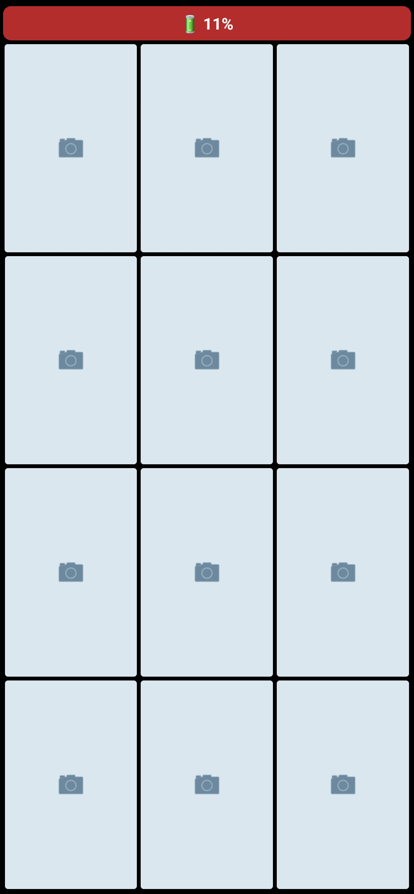
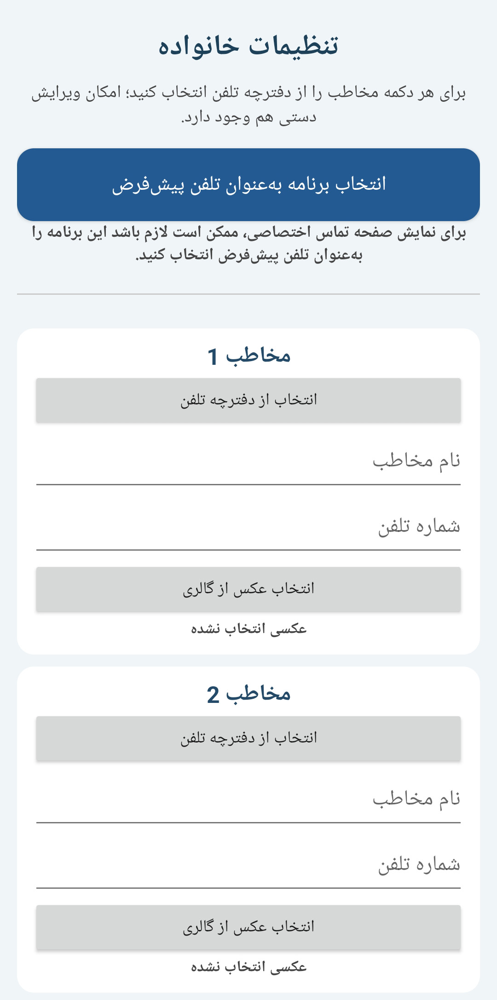
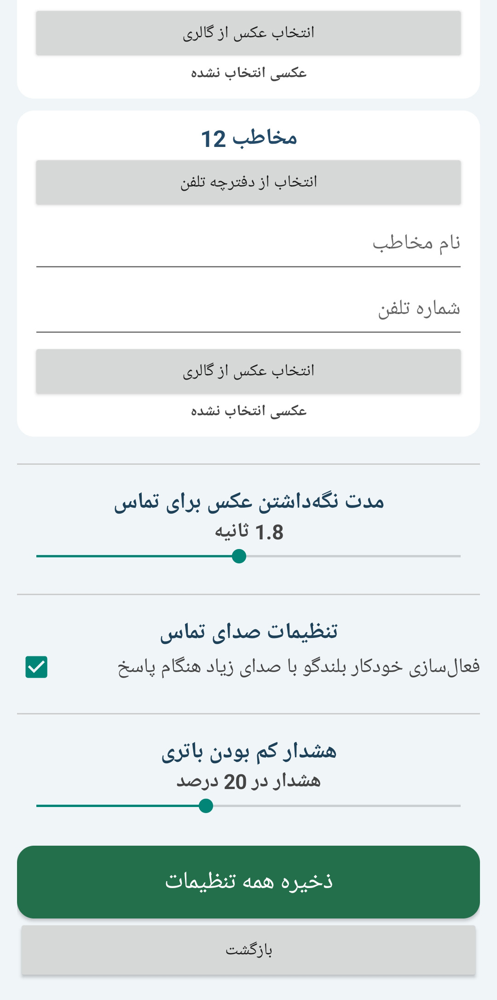

# بی‌بی لانچر | BiBi Launcher

  

  <strong>راهی ساده‌تر برای ارتباط با عزیزان.</strong>
   
  ❤️

بی‌بی یک لانچر ساده و مبتنی بر عکس برای اندروید است که با هدف آسان‌تر کردن برقراری تماس تلفنی برای افرادی طراحی شده است که استفاده از رابط‌های معمول تلفن‌های هوشمند برایشان دشوار است.

مخاطبان اصلی بی‌بی سالمندان، افراد بی‌سواد یا کم‌سواد، افرادی با آشنایی محدود با فناوری و کسانی هستند که یادگیری، به‌خاطرسپردن یا دنبال کردن مراحل متعدد برای برقراری تماس تلفنی برایشان دشوار است.

بی‌بی با استفاده از یک صفحه اصلی خلوت و تصاویر بزرگ مخاطبان، راهی مستقیم‌تر برای تماس با عزیزان فراهم می‌کند؛ بدون اینکه کاربر مجبور باشد در منوهای پیچیده یا فهرست مخاطبان جست‌وجو کند.

---

## 📱 تصاویر برنامه

  
  
  
  
  

---

## 📖 نحوه استفاده

### صفحه اصلی

- برای تماس با یک مخاطب، عکس او را لمس کرده و نگه دارید.
- نشانگر باتری، میزان شارژ فعلی گوشی را نمایش می‌دهد.

### ورود به تنظیمات

برای حفظ سادگی صفحه اصلی و جلوگیری از تغییرات ناخواسته، تنظیمات برنامه عمداً پنهان شده‌اند.

برای ورود به تنظیمات:

۱. نشانگر باتری را پنج بار لمس کنید.

۲. پس از نمایش صفحه رمز، رمز ورود را وارد کنید.

اگر رمز وارد نشود یا صفحه به مدت ۱۵ ثانیه بدون فعالیت باقی بماند، برنامه به‌صورت خودکار به صفحه اصلی بازمی‌گردد.

---

## 🌷 چرا BiBi؟

BiBi (بی‌بی) در زبان فارسی به معنی مادربزرگ است و همچنین به‌عنوان عنوانی محبت‌آمیز و محترمانه برای زنان سالخورده به کار می‌رود.

ایده بی‌بی از یک هدف شخصی شروع شد: آسان‌تر کردن استفاده از گوشی برای مادربزرگم، تا بتواند با زحمت کمتری با اعضای خانواده‌اش تماس بگیرد.

چیزی که ابتدا یک پروژه کوچک خانوادگی بود، حالا به‌صورت عمومی منتشر شده است؛ با این امید که بتواند برای خانواده‌های دیگر نیز مفید باشد.

---

## 🧭 طراحی‌شده برای سادگی

بی‌بی بر پایه یک ایده ساده شکل گرفته است:

**کاربر نباید مجبور باشد برای استفاده از قابلیت‌های ضروری یک دستگاه، پیچیدگی‌های آن را یاد بگیرد.**

تلفن‌های هوشمند امکانات زیادی دارند، اما برقراری یک تماس تلفنی نباید به عبور از چندین منو، خواندن نوشته‌های کوچک یا به‌خاطرسپردن مجموعه‌ای از مراحل وابسته باشد.

بی‌بی عمداً صفحه اصلی را به تعداد محدودی از تعامل‌های ضروری محدود می‌کند. تصاویر بزرگ مخاطبان، راهی بصری و مستقیم برای دسترسی به افراد آشنا فراهم می‌کنند.

این رویکرد می‌تواند استفاده از گوشی را برای افرادی آسان‌تر کند که ممکن است در منوها سردرگم شوند، ناخواسته وارد صفحات ناآشنا شوند یا مراحل انجام یک کار ساده را به‌راحتی به‌خاطر نسپارند.

تنظیمات پنهان نیز به اعضای خانواده یا مراقبان اجازه می‌دهد در صورت نیاز برنامه را پیکربندی کنند، در حالی که تجربه روزمره کاربر ساده و قابل‌پیش‌بینی باقی می‌ماند.

هدف بی‌بی محدود کردن کاربران نیست؛ بلکه کاهش موانع غیرضروری و فراهم کردن امکان ارتباط تلفنی ساده‌تر و مستقل‌تر است.

---

## 📱 سازگاری

آزمایش‌شده روی:

- Samsung Galaxy J5 (SM-J500H)
- اندروید 6.0.1

سازگاری با سایر دستگاه‌ها و نسخه‌های اندروید ممکن است متفاوت باشد.

---

## 🛠️ فناوری‌های استفاده‌شده

- Java
- Android SDK
- Android Studio
- GitHub Actions

---

## 🚧 وضعیت پروژه

بی‌بی یک پروژه آزمایشی و در حال توسعه است.

ممکن است برخی قابلیت‌ها هنوز کامل نشده باشند یا عملکرد آن‌ها به دستگاه و نسخه اندروید وابسته باشد.

---

## 🤝 مشارکت

از پیشنهادها، بازخوردها و مشارکت در توسعه پروژه استقبال می‌کنم.

اگر ایده‌ای دارید که می‌تواند برقراری تماس تلفنی را برای افرادی که استفاده از گوشی‌های هوشمند برایشان دشوار است ساده‌تر یا دسترس‌پذیرتر کند، می‌توانید یک Issue ثبت کنید یا در توسعه پروژه مشارکت داشته باشید.

---

## 🔒 حریم خصوصی

پیش از استفاده یا انتشار برنامه، مجوزها و کد منبع آن را بررسی کنید.

لطفاً اطلاعات تماس خصوصی یا عکس‌های شخصی را در Issueها یا اسکرین‌شات‌های عمومی منتشر نکنید.
