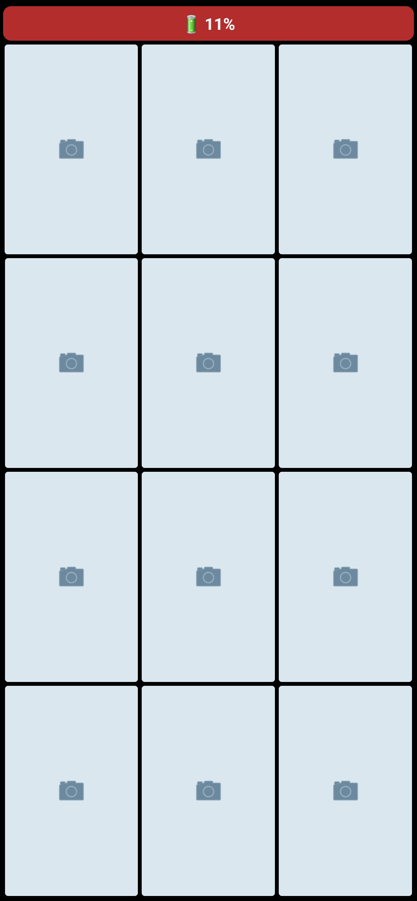
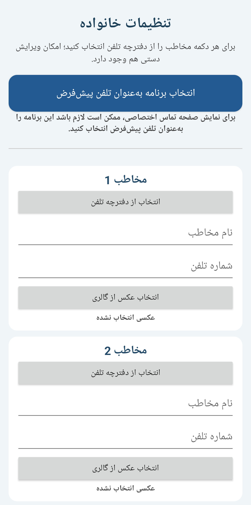

# BiBi Launcher

  

  <strong>A simpler way to stay connected.</strong>
   
  ❤️

BiBi is a simple, photo-based Android launcher designed to make phone calls easier for people who find traditional smartphone interfaces difficult to use.

With a minimal home screen and large contact photos, BiBi provides a more direct way to reach loved ones without navigating through complicated menus or contact lists.

---

## 👥 Who Is BiBi For?

BiBi is designed for people who find conventional smartphone interfaces difficult to use, especially:

- **Older adults:** People who want a simpler way to call family members and loved ones.
- **People with limited or no literacy:** Those who cannot easily read or navigate text-based menus.
- **People unfamiliar with technology:** Those who have little experience using smartphones or digital devices.
- **People who find complex interactions difficult:** Those who struggle with learning, remembering, or following multiple steps to complete a task.
- **People who prefer a simpler phone experience:** Anyone who wants a minimal interface focused on essential functions rather than unnecessary options.

BiBi aims to make phone communication easier and more accessible, regardless of age, literacy level, or familiarity with technology.

---

## 📱 Screenshots

  
  
  
  
  

---

## 📖 How to Use

### Home Screen

- Tap and hold a contact's photo to call them.
- The battery indicator shows the current battery level.

### Accessing Settings

Settings are intentionally hidden to keep the home screen simple and reduce accidental changes.

To open settings:

1. Tap the battery indicator five times.
2. Enter the access code when prompted.

If the code is not entered or the screen remains inactive, the settings screen returns to the home screen automatically after 15 seconds.

---

## 🌷 Why BiBi?

BiBi (بی‌بی) is a Persian word meaning grandmother. It is also used as an affectionate and respectful title for older women.

The idea began with a personal goal: making smartphone use easier for my grandmother, so she could reach her family with less effort.

What started as a small family project is now shared in the hope that it may help other families, too.

---

## 🧭 Designed to Stay Simple

BiBi is built around a simple idea:

**People should not have to learn the complexity of a device just to use its essential functions.**

Smartphones offer many features, but making a phone call should not require navigating through multiple menus, reading small text, or remembering a series of steps.

BiBi intentionally keeps the home screen limited to a few essential interactions. Large contact photos provide a visual and direct way to reach familiar people.

This approach can make phone use easier for people who may otherwise get lost in menus, open unfamiliar screens, or struggle to remember how to complete a simple task.

The hidden settings allow family members or caregivers to configure the app when needed, while keeping the everyday experience simple and predictable.

The goal is not to limit users, but to remove unnecessary barriers and make phone communication more accessible and independent.

---

## 📱 Compatibility

Tested on:

- Samsung Galaxy J5 (SM-J500H)
- Android 6.0.1

Compatibility with other devices and Android versions may vary.

---

## 🛠️ Built With

- Java
- Android SDK
- Android Studio
- GitHub Actions

---

## 🚧 Project Status

BiBi is an experimental project under development.

Some features may be incomplete or device-dependent.

---

## 🤝 Contributions

Suggestions, feedback, and contributions are welcome.

If you have an idea that could make phone communication simpler or more accessible for people who find smartphones difficult to use, feel free to open an issue or contribute to the project.

---

## 🔒 Privacy

Please review the app's permissions and source code before using or distributing it.

Avoid sharing private contact information or personal photos in public issues or screenshots.

---

## 🇮🇷 فارسی

# بی‌بی لانچر | BiBi Launcher

  

  <strong>راهی ساده‌تر برای ارتباط با عزیزان.</strong>
   
  ❤️

بی‌بی یک لانچر ساده و مبتنی بر عکس برای اندروید است که با هدف آسان‌تر کردن برقراری تماس تلفنی برای افرادی طراحی شده است که استفاده از رابط‌های معمول تلفن‌های هوشمند برایشان دشوار است.

بی‌بی با استفاده از یک صفحه اصلی خلوت و تصاویر بزرگ مخاطبان، راهی مستقیم‌تر برای تماس با عزیزان فراهم می‌کند؛ بدون اینکه کاربر مجبور باشد در منوهای پیچیده یا فهرست مخاطبان جست‌وجو کند.

---

## 👥 بی‌بی برای چه کسانی مناسب است؟

بی‌بی برای افرادی طراحی شده است که استفاده از رابط‌های معمول تلفن‌های هوشمند برایشان دشوار است؛ به‌ویژه:

- **سالمندان:** افرادی که می‌خواهند بدون درگیری با منوها و مراحل پیچیده، با اعضای خانواده و عزیزان خود تماس بگیرند.
- **افراد بی‌سواد یا کم‌سواد:** کسانی که خواندن نوشته‌ها و کار با منوهای متنی برایشان دشوار است.
- **افراد ناآشنا با فناوری:** کسانی که تجربه یا مهارت زیادی در استفاده از گوشی‌های هوشمند و ابزارهای دیجیتال ندارند.
- **افرادی که با مراحل پیچیده مشکل دارند:** کسانی که یادگیری، به‌خاطرسپردن یا دنبال کردن چند مرحله متوالی برای انجام یک کار برایشان دشوار است.
- **افرادی که رابط کاربری ساده را ترجیح می‌دهند:** کسانی که به‌جای امکانات و گزینه‌های متعدد، به محیطی خلوت و متمرکز بر قابلیت‌های ضروری نیاز دارند.

هدف بی‌بی این است که برقراری تماس تلفنی را مستقل از سن، میزان سواد یا آشنایی افراد با فناوری، ساده‌تر و دسترس‌پذیرتر کند.

---

## 📱 تصاویر برنامه

  
  
  
  
  

---

## 📖 نحوه استفاده

### صفحه اصلی

- برای تماس با یک مخاطب، عکس او را لمس کرده و نگه دارید.
- نشانگر باتری، میزان شارژ فعلی گوشی را نمایش می‌دهد.

### ورود به تنظیمات

برای حفظ سادگی صفحه اصلی و جلوگیری از تغییرات ناخواسته، تنظیمات برنامه عمداً پنهان شده‌اند.

برای ورود به تنظیمات:

۱. نشانگر باتری را پنج بار لمس کنید.

۲. پس از نمایش صفحه رمز، رمز ورود را وارد کنید.

اگر رمز وارد نشود یا صفحه به مدت ۱۵ ثانیه بدون فعالیت باقی بماند، برنامه به‌صورت خودکار به صفحه اصلی بازمی‌گردد.

---

## 🌷 چرا BiBi؟

BiBi (بی‌بی) در زبان فارسی به معنی مادربزرگ است و همچنین به‌عنوان عنوانی محبت‌آمیز و محترمانه برای زنان سالخورده به کار می‌رود.

ایده بی‌بی از یک هدف شخصی شروع شد: آسان‌تر کردن استفاده از گوشی برای مادربزرگم، تا بتواند با زحمت کمتری با اعضای خانواده‌اش تماس بگیرد.

چیزی که ابتدا یک پروژه کوچک خانوادگی بود، حالا به‌صورت عمومی منتشر شده است؛ با این امید که بتواند برای خانواده‌های دیگر نیز مفید باشد.

---

## 🧭 طراحی‌شده برای سادگی

بی‌بی بر پایه یک ایده ساده شکل گرفته است:

**کاربر نباید مجبور باشد برای استفاده از قابلیت‌های ضروری یک دستگاه، پیچیدگی‌های آن را یاد بگیرد.**

تلفن‌های هوشمند امکانات زیادی دارند، اما برقراری یک تماس تلفنی نباید به عبور از چندین منو، خواندن نوشته‌های کوچک یا به‌خاطرسپردن مجموعه‌ای از مراحل وابسته باشد.

بی‌بی عمداً صفحه اصلی را به تعداد محدودی از تعامل‌های ضروری محدود می‌کند. تصاویر بزرگ مخاطبان، راهی بصری و مستقیم برای دسترسی به افراد آشنا فراهم می‌کنند.

این رویکرد می‌تواند استفاده از گوشی را برای افرادی آسان‌تر کند که ممکن است در منوها سردرگم شوند، ناخواسته وارد صفحات ناآشنا شوند یا مراحل انجام یک کار ساده را به‌راحتی به‌خاطر نسپارند.

تنظیمات پنهان نیز به اعضای خانواده یا مراقبان اجازه می‌دهد در صورت نیاز برنامه را پیکربندی کنند، در حالی که تجربه روزمره کاربر ساده و قابل‌پیش‌بینی باقی می‌ماند.

هدف بی‌بی محدود کردن کاربران نیست؛ بلکه کاهش موانع غیرضروری و فراهم کردن امکان ارتباط تلفنی ساده‌تر و مستقل‌تر است.

---

## 📱 سازگاری

آزمایش‌شده روی:

- Samsung Galaxy J5 (SM-J500H)
- اندروید 6.0.1

سازگاری با سایر دستگاه‌ها و نسخه‌های اندروید ممکن است متفاوت باشد.

---

## 🛠️ فناوری‌های استفاده‌شده

- Java
- Android SDK
- Android Studio
- GitHub Actions

---

## 🚧 وضعیت پروژه

بی‌بی یک پروژه آزمایشی و در حال توسعه است.

ممکن است برخی قابلیت‌ها هنوز کامل نشده باشند یا عملکرد آن‌ها به دستگاه و نسخه اندروید وابسته باشد.

---

## 🤝 مشارکت

از پیشنهادها، بازخوردها و مشارکت در توسعه پروژه استقبال می‌کنم.

اگر ایده‌ای دارید که می‌تواند برقراری تماس تلفنی را برای افرادی که استفاده از گوشی‌های هوشمند برایشان دشوار است ساده‌تر یا دسترس‌پذیرتر کند، می‌توانید یک Issue ثبت کنید یا در توسعه پروژه مشارکت داشته باشید.

---

## 🔒 حریم خصوصی

پیش از استفاده یا انتشار برنامه، مجوزها و کد منبع آن را بررسی کنید.

لطفاً اطلاعات تماس خصوصی یا عکس‌های شخصی را در Issueها یا اسکرین‌شات‌های عمومی منتشر نکنید.
