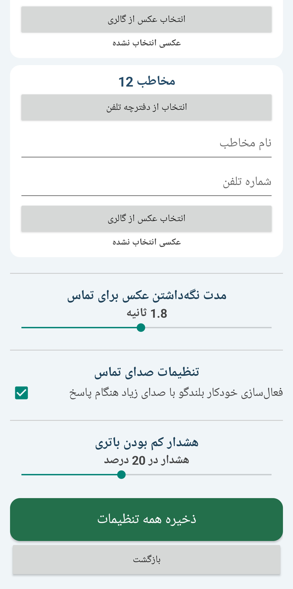

BiBi Launcher

  

  <strong>A simpler way to stay connected.</strong>
   
  ❤️

BiBi is a simple, photo-based Android launcher designed to make smartphones easier to use for elderly people and anyone who finds traditional smartphone interfaces difficult.

With a minimal home screen and large contact photos, BiBi makes reaching loved ones easier and more intuitive.

---

📱 Screenshots

  
  
  
  
  

---

📖 How to Use

Home Screen

- Tap and hold a contact's photo to call them.
- The battery indicator shows the current battery level.

Accessing Settings

Settings are intentionally hidden to keep the home screen simple.

To open settings:

1. Tap the battery indicator five times.
2. Enter the access code when prompted.

If the code is not entered or the screen remains inactive, the settings screen returns to the home screen automatically after 15 seconds.

---

🌷 Why BiBi?

BiBi (بی‌بی) is a Persian word meaning grandmother. It is also used as an affectionate and respectful title for older women.

The idea began with a personal goal: making smartphone use easier for my grandmother, so she could reach her family with less effort.

What started as a small family project is now shared in the hope that it may help other families, too.

---

🧭 Designed to Stay Simple

BiBi is intentionally designed with a limited number of visible options.

Instead of offering every feature of a traditional smartphone interface, BiBi focuses on a few essential interactions.

This helps reduce the chances of elderly users getting lost in menus, opening unfamiliar screens, or accidentally making the phone difficult to use.

The hidden settings allow family members or caregivers to configure the app when needed, while keeping the everyday experience simple and predictable.

---

📱 Compatibility

Tested on:

- Samsung Galaxy J5 (SM-J500H)
- Android 6.0.1

Compatibility with other devices and Android versions may vary.

---

🛠️ Built With

- Java
- Android SDK
- Android Studio
- GitHub Actions

---

🚧 Project Status

BiBi is an experimental project under development.

Some features may be incomplete or device-dependent.

---

🤝 Contributions

Suggestions, feedback, and contributions are welcome.

If you have an idea that could make smartphones easier for elderly people to use, feel free to open an issue or contribute to the project.

---

🔒 Privacy

Please review the app's permissions and source code before using or distributing it.

Avoid sharing private contact information or personal photos in public issues or screenshots.

---

🇮🇷 فارسی

بی‌بی لانچر

  <strong>راهی ساده‌تر برای ارتباط با عزیزان.</strong>
   
  ❤️

بی‌بی یک لانچر ساده و مبتنی بر عکس برای اندروید است که با هدف آسان‌تر کردن استفاده از گوشی‌های هوشمند برای سالمندان و افرادی ساخته می‌شود که کار با رابط‌های معمول گوشی برایشان دشوار است.

بی‌بی با صفحه‌ای خلوت و عکس‌های بزرگ مخاطبان، دسترسی به عزیزان را ساده‌تر و قابل‌فهم‌تر می‌کند.

---

📱 تصاویر برنامه

  
  
  
  
  

---

📖 نحوه استفاده

صفحه‌ی اصلی

- برای تماس با یک مخاطب، عکس او را لمس کرده و نگه دارید.
- نوار باتری، میزان شارژ فعلی گوشی را نمایش می‌دهد.

ورود به تنظیمات

برای خلوت ماندن صفحه‌ی اصلی، تنظیمات عمداً پنهان شده‌اند.

برای ورود به تنظیمات:
۱. نوار نمایش باتری را پنج بار لمس کنید.
۲. پس از نمایش صفحه‌ی رمز، رمز ورود را وارد کنید.

اگر رمز وارد نشود یا صفحه به مدت ۱۵ ثانیه بدون فعالیت باقی بماند، برنامه به‌صورت خودکار به صفحه‌ی اصلی بازمی‌گردد.

---

🌷 چرا BiBi؟

BiBi (بی‌بی) در زبان فارسی به معنی مادربزرگ است و همچنین به‌عنوان عنوانی محبت‌آمیز و محترمانه برای زنان سالخورده به کار می‌رود.

ایده‌ی بی‌بی از یک هدف شخصی شروع شد: آسان‌تر کردن استفاده از گوشی برای مادربزرگم، تا بتواند با زحمت کمتری به خانواده‌اش دسترسی داشته باشد.

چیزی که ابتدا یک پروژه‌ی کوچک خانوادگی بود، حالا به‌صورت عمومی منتشر شده تا شاید برای خانواده‌های دیگر هم مفید باشد.

---

🧭 طراحی‌شده برای سادگی

بی‌بی عمداً با تعداد محدودی از گزینه‌های قابل مشاهده طراحی شده است.

بی‌بی به‌جای ارائه‌ی تمام قابلیت‌های یک رابط معمول گوشی هوشمند، بر تعداد محدودی از تعامل‌های ضروری تمرکز می‌کند.

این کار به کاهش احتمال گم‌شدن سالمند در منوها، ورود به صفحات ناآشنا یا دشوار شدن استفاده از گوشی کمک می‌کند.

تنظیمات پنهان به اعضای خانواده یا مراقبان اجازه می‌دهد در صورت نیاز برنامه را تنظیم کنند، در حالی که تجربه‌ی روزمره‌ی استفاده از گوشی ساده و قابل‌پیش‌بینی باقی می‌ماند.

---

📱 سازگاری

آزمایش‌شده روی:

- Samsung Galaxy J5 (SM-J500H)
- اندروید 6.0.1

سازگاری با سایر دستگاه‌ها و نسخه‌های اندروید ممکن است متفاوت باشد.

---

🛠️ فناوری‌های استفاده‌شده

- Java
- Android SDK
- Android Studio
- GitHub Actions

---

🚧 وضعیت پروژه

بی‌بی یک پروژه‌ی آزمایشی و در حال توسعه است.

ممکن است برخی قابلیت‌ها هنوز کامل نشده باشند یا به دستگاه و نسخه‌ی اندروید وابسته باشند.

---

🤝 مشارکت

از پیشنهادها، بازخوردها و مشارکت استقبال می‌کنم.

اگر ایده‌ای دارید که می‌تواند استفاده از گوشی‌های هوشمند را برای سالمندان آسان‌تر کند، می‌توانید یک Issue ثبت کنید یا در توسعه‌ی پروژه مشارکت داشته باشید.

---

🔒 حریم خصوصی

پیش از استفاده یا انتشار برنامه، مجوزها و کد منبع آن را بررسی کنید.

لطفاً اطلاعات تماس خصوصی یا عکس‌های شخصی را در Issueها یا اسکرین‌شات‌های عمومی منتشر نکنید.
